<p align="center">
  <picture>
    <source media="(prefers-color-scheme: dark)" srcset="docs/assets/hero-dark.svg">
    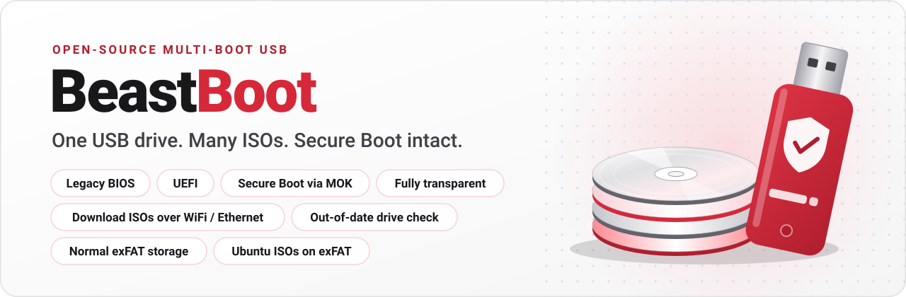
  </picture>
</p>

<p align="center">
  <a href="LICENSE"></a>
  <a href="VERSION"></a>
  <a href="docs/ARCHITECTURE.md#2-boot-flows"></a>
  <br>
  <a href="sbom/README.md"></a>
  <a href="sbom/README.md"></a>
  <a href="https://github.com/cynak/BeastBoot/releases"></a>
  <a href="docs/CODE_QUALITY.md"></a>
</p>

<p align="center">
  <strong>An open-source, fully transparent multi-boot USB drive, in the spirit of Ventoy.</strong><br>
  Copy <code>.iso</code> files onto a drive that stays normal storage and boot them on BIOS or UEFI.<br>
  Secure Boot can stay on: nothing is disabled or bypassed.
</p>

<p align="center">
  <a href="#screenshots">Screenshots</a> ·
  <a href="#download-and-use">Download</a> ·
  <a href="#quick-start">Quick&nbsp;start</a> ·
  <a href="#how-it-works">How&nbsp;it&nbsp;works</a> ·
  <a href="#secure-boot">Secure&nbsp;Boot</a> ·
  <a href="#download-an-iso-from-a-link">Network&nbsp;download</a> ·
  <a href="#documentation">Docs</a> ·
  <a href="#roadmap">Roadmap</a>
</p>

## What it is

- **Copy ISOs, boot them.** The drive stays a normal storage drive (exFAT by
  default). Drop `.iso` files anywhere on it, in any folders. When you boot
  from it, a graphical menu lists the ISOs and lets you browse folders.
- **Boots everywhere.** Legacy BIOS, UEFI, and UEFI with Secure Boot on.
- **Secure Boot done properly.** Microsoft-signed shim, then beast-booter's
  GRUB 2.14 signed with a beast-booter key that *you* enroll once in
  MokManager. Nothing is disabled or bypassed. An ISO whose kernel your
  machine doesn't trust is refused, with an explanation.
- **Download an ISO from the boot menu.** A small Linux helper connects over
  Ethernet or WiFi, downloads an ISO over HTTPS, checks it and boots it.
- **Fully transparent.** Every file placed on the drive is built from this
  repo or copied unmodified from a named Ubuntu package, and listed with its
  origin and SHA-256 in a manifest you can verify. Every release publishes an
  SBOM and a vulnerability report.
- **One app for Linux, Windows and macOS.** A desktop app and a command line,
  in plain Python, shipped as portable packages that need no installation.

> Status: **0.1, in development.** See the [roadmap](#roadmap) and the
> [known Secure Boot limits](#secure-boot).

## Screenshots

<table>
<tr>
<td width="50%" valign="top">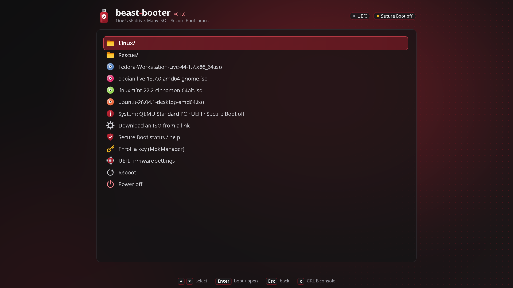<br>
<sub><b>Boot menu.</b> ISOs and folders on the drive, each with its distribution's icon, then the tools.</sub></td>
<td width="50%" valign="top">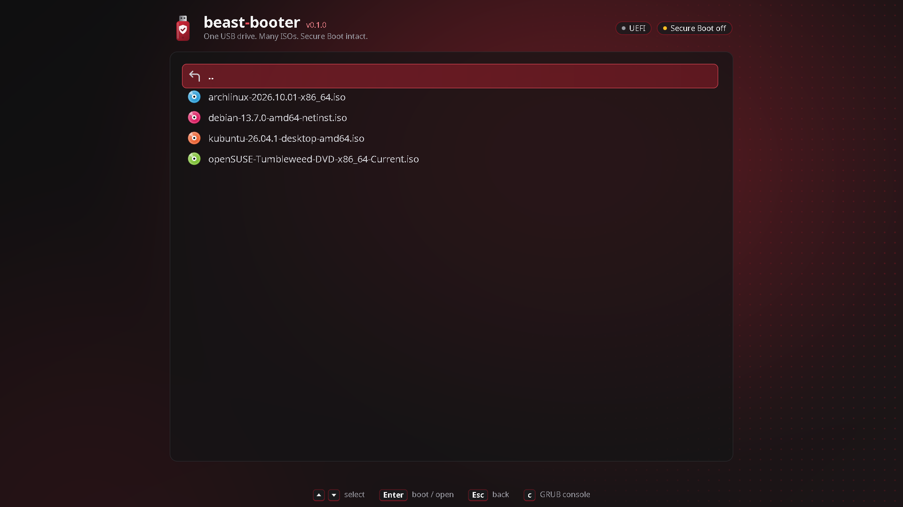<br>
<sub><b>Folders.</b> Any folder on the drive opens as its own list; Esc goes back.</sub></td>
</tr>
<tr>
<td width="50%" valign="top">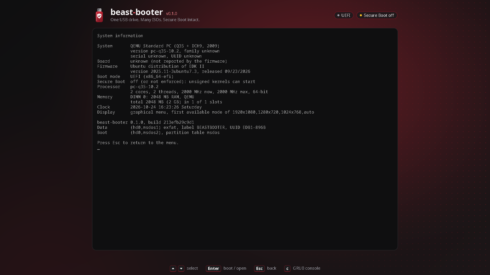<br>
<sub><b>System information.</b> What the firmware reports: board, CPU, memory, boot mode, Secure Boot.</sub></td>
<td width="50%" valign="top">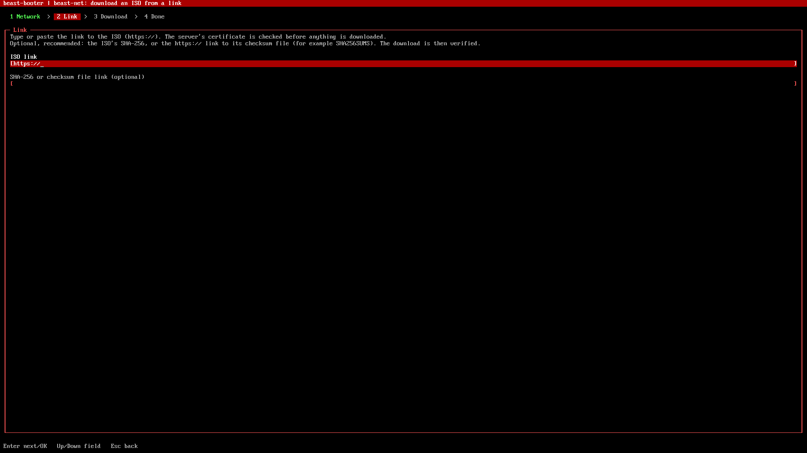<br>
<sub><b>Download an ISO from a link.</b> The network helper asks for a link, downloads it over HTTPS and checks it.</sub></td>
</tr>
<tr>
<td width="50%" valign="top">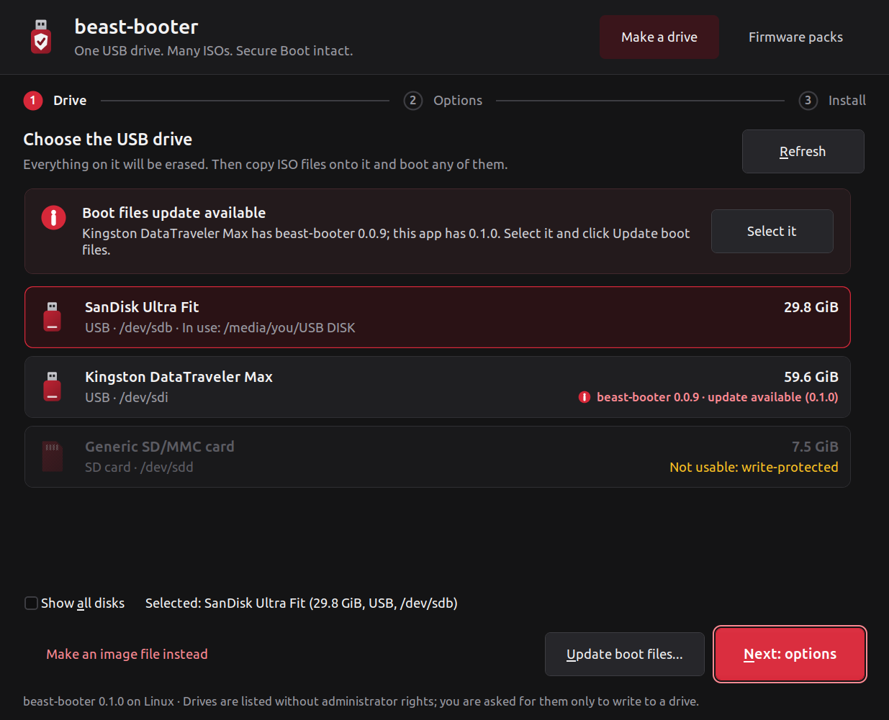<br>
<sub><b>The app: choose the drive.</b> Only removable drives are offered; system and read-only disks are refused.</sub></td>
<td width="50%" valign="top">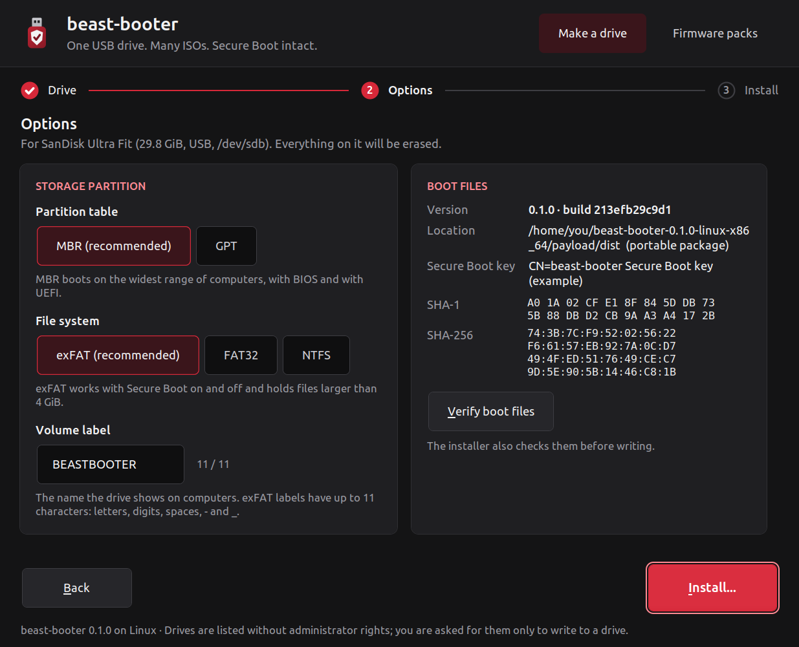<br>
<sub><b>Options.</b> File system, partition table, label, and the boot files with their Secure Boot key fingerprints.</sub></td>
</tr>
<tr>
<td width="50%" valign="top">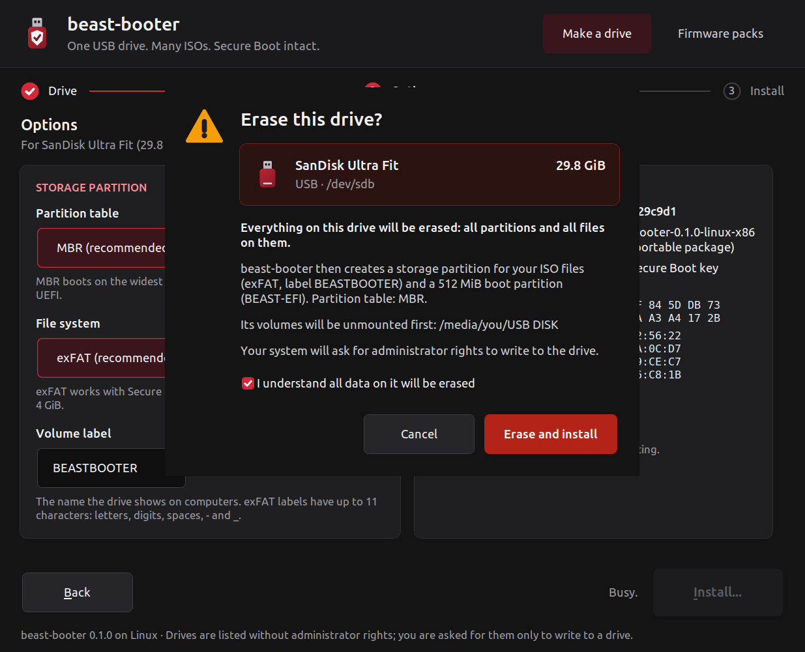<br>
<sub><b>Nothing is erased by accident.</b> You tick a box before the drive is erased.</sub></td>
<td width="50%" valign="top">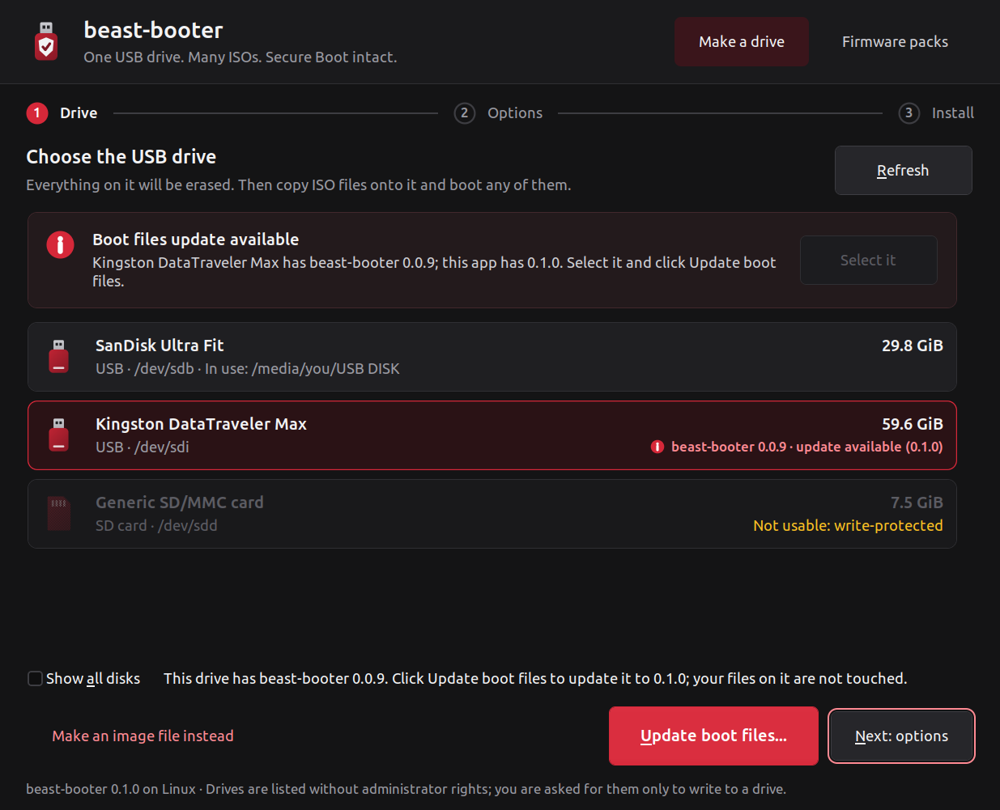<br>
<sub><b>Out-of-date drives are pointed out.</b> A drive with older boot files gets a notice and one-click Update boot files; your files on it stay.</sub></td>
</tr>
</table>

<details>
<summary>More of the app</summary>

<table>
<tr>
<td width="50%" valign="top">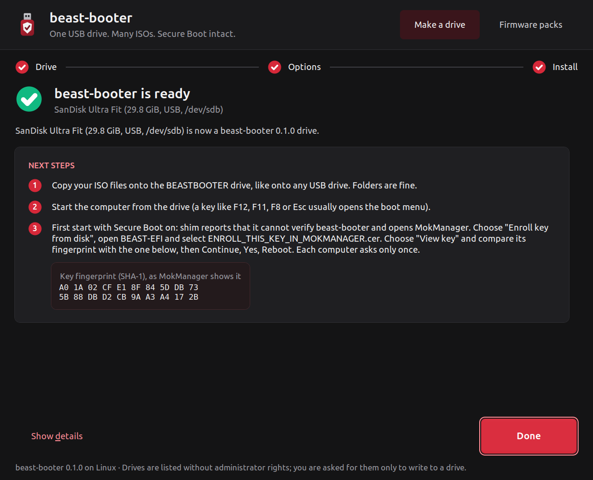<br>
<sub><b>Ready.</b> Next steps, with the key fingerprint to compare in MokManager.</sub></td>
<td width="50%" valign="top">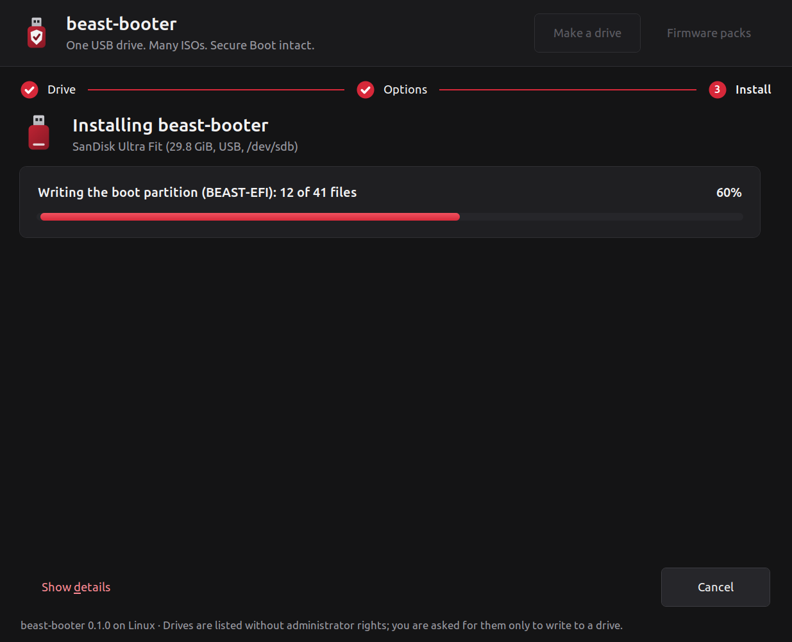<br>
<sub><b>Installing.</b> Every step is shown; details are one click away.</sub></td>
</tr>
<tr>
<td width="50%" valign="top">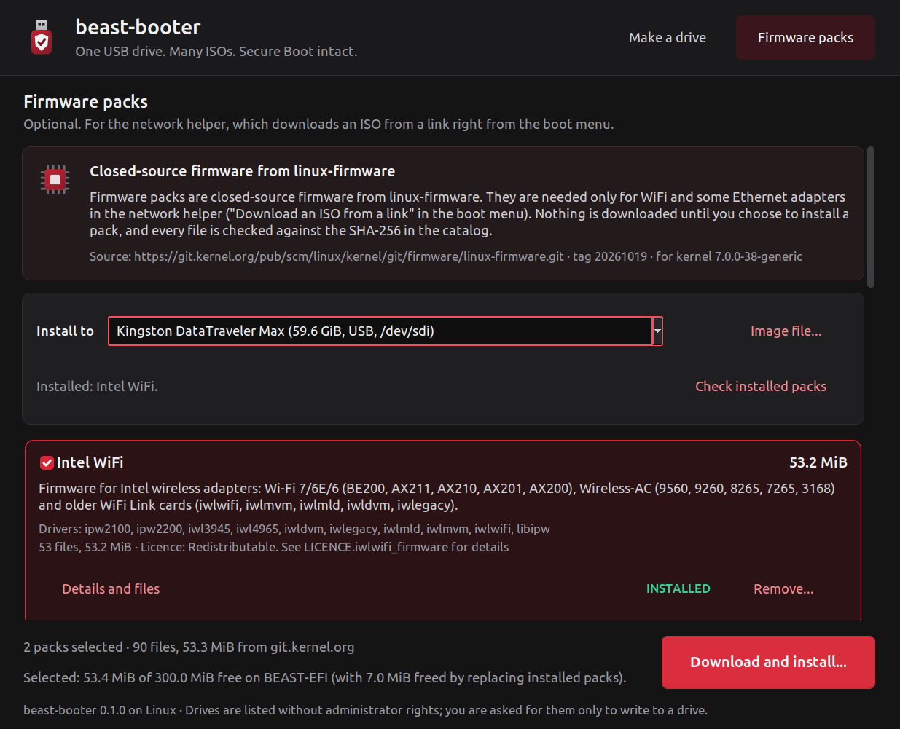<br>
<sub><b>Firmware packs.</b> Optional WiFi and Ethernet firmware for the download helper, from linux-firmware, every file checked by SHA-256. What a drive already has is shown without a password.</sub></td>
<td width="50%" valign="top">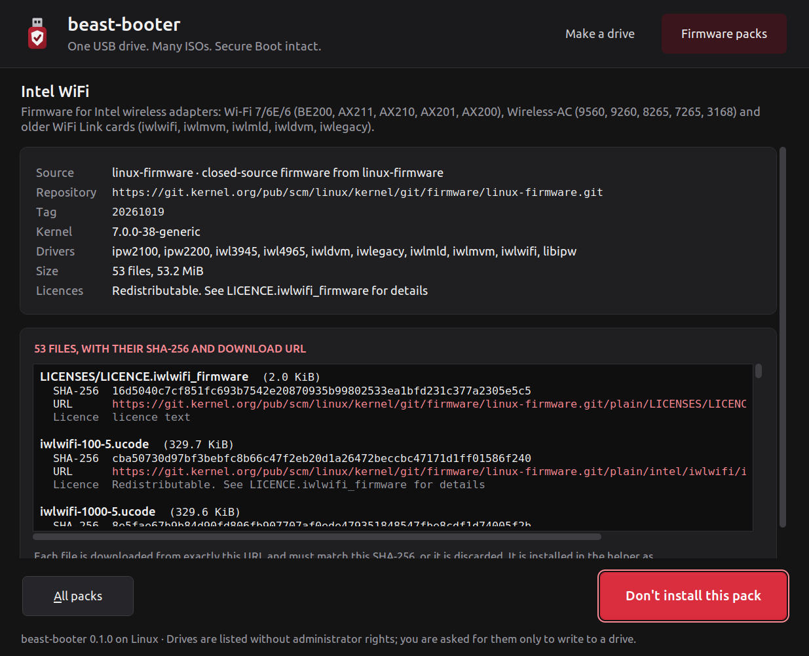<br>
<sub><b>Every file, its source and its SHA-256.</b> </sub></td>
</tr>
<tr>
<td width="50%" valign="top">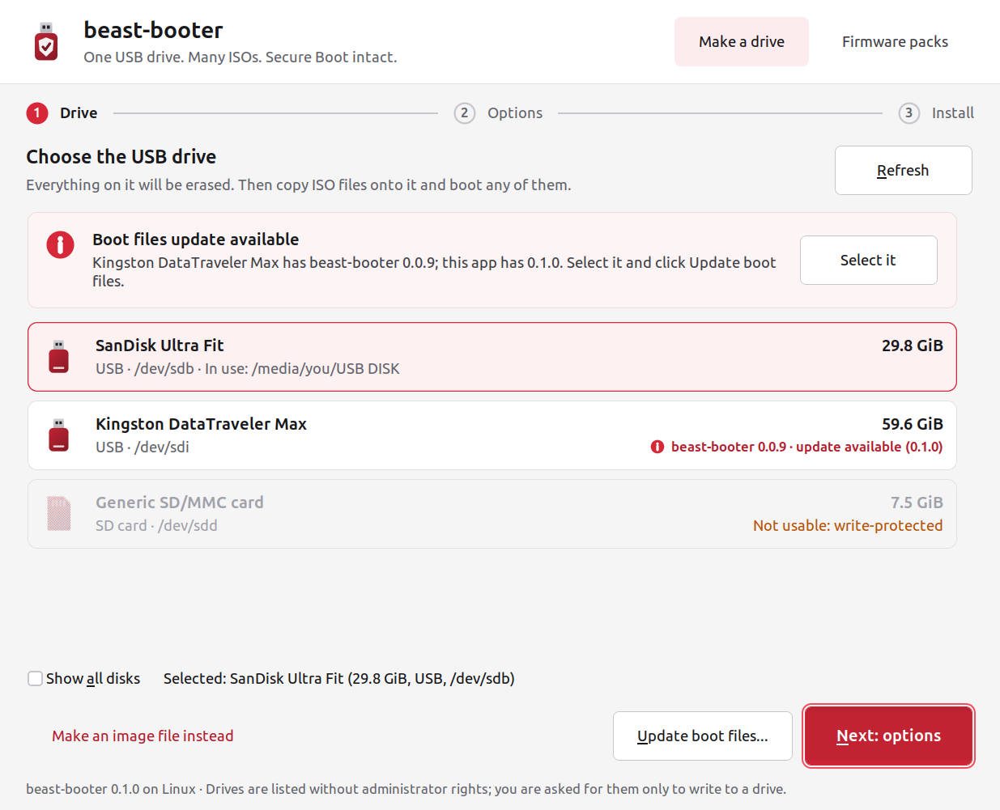<br>
<sub><b>Light theme.</b> </sub></td>
<td width="50%"></td>
</tr>
</table>

</details>

The boot menu pictures are from QEMU; the app pictures use its demo mode (simulated drives, an
example Secure Boot key). [`scripts/make_screenshots.sh`](scripts/make_screenshots.sh) takes them all
again; the colours are in [docs/assets/BRAND.md](docs/assets/BRAND.md).

## Download and use

Each [release](https://github.com/cynak/BeastBoot/releases) has a portable package per OS. Unpack it
and run it; nothing is installed.

| OS | File | Start |
|---|---|---|
| Windows 10+ (x86_64) | `beast-booter-<v>-windows-x86_64.zip` | `BeastBooter.cmd` |
| macOS, Apple silicon | `beast-booter-<v>-macos-arm64.zip` | `BeastBooter.app` |
| macOS, Intel | `beast-booter-<v>-macos-x86_64.zip` | `BeastBooter.app` |
| Linux (x86_64) | `beast-booter-<v>-linux-x86_64.tar.gz` | `./BeastBooter` |

Check the download against the release's `SHA256SUMS` first (how:
[SECURITY.md](SECURITY.md#verifying-a-release)). The apps are not code
signed yet, so Windows SmartScreen and macOS Gatekeeper warn on the first
start; [docs/PORTABLE.md](docs/PORTABLE.md#run-it) says how to get past
them. The window runs as you; only writing to the USB drive asks for
administrator rights.

The same package has the command line (`beast-booter.cmd`,
`beast-booter.command`, `./beast-booter`):

```sh
beast-booter list-devices                      # drives you can write to
beast-booter install --device /dev/sdX         # make a beast-booter drive (ERASES it)
beast-booter update  --device /dev/sdX         # new boot files, your ISOs stay
beast-booter info    --device /dev/sdX         # show the drive's layout
beast-booter firmware catalog                  # optional WiFi/Ethernet firmware packs
```

`--device` is `/dev/sdX` on Linux, `/dev/diskN` on macOS and
`\\.\PhysicalDriveN` (or `N`) on Windows. `--image FILE --size 8G` makes a
disk image instead, without administrator rights. Every command has
`--help`.

## Quick start

1. Start **BeastBooter**, choose the USB drive, click **Next: options**,
   keep the defaults (exFAT, MBR) and click **Install...**. Everything on
   the drive is erased.
2. Copy `.iso` files onto the drive's `BEASTBOOTER` partition, in any folders.
3. Boot the computer from the drive (its one-time boot menu key, often F12,
   F11, F10, F8 or Esc) and pick an ISO.
4. With Secure Boot on, enroll the beast-booter key once per computer (below).

The step-by-step version, with every option and the common errors:
[docs/USER_GUIDE.md](docs/USER_GUIDE.md).

## How it works

```
 USB drive
 ├── partition 1  "BEASTBOOTER"  exFAT / FAT32 / NTFS   your files and ISOs
 └── partition 2  "BEAST-EFI"    FAT32, 512 MiB         boot files: shim, GRUB, menu, theme, network helper
```

On boot, GRUB finds partition 1, lists the `.iso` files and folders, and
boots the one you choose with a recipe for its distribution family
(Ubuntu/casper, Debian live, Arch, Fedora live and installer, openSUSE, or
the ISO's own `loopback.cfg`). Updating rewrites only partition 2 and the
boot code; your files are never touched. Settings go in
`/beast-booter/config.cfg` on the drive ([docs/MENU.md](docs/MENU.md)).
Details: [docs/ARCHITECTURE.md](docs/ARCHITECTURE.md),
[docs/ISO_SUPPORT.md](docs/ISO_SUPPORT.md).

## Secure Boot

On the first boot with Secure Boot on, shim reports that it can't verify
beast-booter and opens MokManager. Choose **Enroll key from disk**, select
`ENROLL_THIS_KEY_IN_MOKMANAGER.cer` on the `BEAST-EFI` volume, check the
fingerprint, confirm, and reboot. This is a one-time step per computer.
ISOs then boot if their kernel is signed by a key the machine trusts
(Ubuntu and its flavours out of the box; other distributions after you
enroll their key; unsigned ones only with Secure Boot off).

**Known limits in 0.1** (Secure Boot on only):

- a PC that has applied the November 2025 SBAT revocation (`grub,6`)
  refuses our GRUB, which is Ubuntu's 2.14 build and truthfully says
  `grub,5`;
- a PC whose firmware trusts only Microsoft's 2023 UEFI CA refuses our shim,
  which is signed only by the 2011 CA.

Both are fixed by shipping a newer GRUB and shim from Ubuntu's updates;
beast-booter will not fake the SBAT number. With an NTFS data partition,
GRUB cannot see your ISOs under Secure Boot; use exFAT or FAT32. Full
guide: [docs/SECURE_BOOT.md](docs/SECURE_BOOT.md).

## Download an ISO from a link

The menu entry **Download an ISO from a link** starts beast-net, a small
helper built from Ubuntu's Canonical-signed kernel (so it works with Secure
Boot on). It brings up Ethernet by DHCP or joins a WiFi network, downloads
an ISO over HTTPS into `/downloads/` with resume, checks an optional SHA-256
(required for plain `http://`), and reboots into the menu to boot it once.

Many WiFi chips need closed-source firmware, which beast-booter does not
ship. If you want it, install a **firmware pack** from the desktop app
(**Firmware packs**) or with `beast-booter firmware fetch` and
`beast-booter firmware install`. Each pack's files come from the upstream
`linux-firmware` repository at one pinned tag; the app shows the source URL
and every SHA-256 before it downloads anything, and checks them all.
Details: [docs/BEASTNET.md](docs/BEASTNET.md).

## SBOM and vulnerabilities

beast-booter puts third-party code in the boot chain (GNU GRUB, shim and a
Linux kernel from Ubuntu's packages), so every release publishes what it
ships and what is known to be wrong with it:

| Release file | Contents |
|---|---|
| `beast-booter-<v>-sbom.cdx.json` | software bill of materials, CycloneDX 1.6 |
| `beast-booter-<v>-sbom.spdx.json` | the same in SPDX 2.3 |
| `beast-booter-<v>-vulnerabilities.json` | known vulnerabilities, machine-readable, with VEX status |
| `beast-booter-<v>-VULNERABILITIES.md` | the same for people, with how each one is remediated |

To produce them for your own build: `make build`, then `make vulns`. Besides
CVEs (grype, osv-scanner), the scan checks boot-chain risks that CVE
databases miss: SBAT revocation levels, the certificates that signed shim
and GRUB, and the UEFI revocation list (dbx). Triage decisions are kept in
[`sbom/vex.openvex.json`](sbom/vex.openvex.json). How it all fits:
[sbom/README.md](sbom/README.md). To report a vulnerability:
[SECURITY.md](SECURITY.md).

## Develop

```sh
make dev       # toolchain (rootless, into .tools/), .venv, signing key, dist/, tests, dev image
make doctor    # what is missing and how to fix it
make test      # installer unit tests
make e2e       # 84 end-to-end tests in QEMU: BIOS, UEFI, Secure Boot, beast-net
make lint      # ruff + ShellCheck
make vm        # boot the dev image in QEMU (MODE=bios|uefi|sb|sb-enrolled|sb-fresh)
```

No root needed. Guide: [docs/DEVELOPMENT.md](docs/DEVELOPMENT.md).
How to contribute: [CONTRIBUTING.md](CONTRIBUTING.md).

## Build

```sh
make keys       # your own Secure Boot signing key in keys/
make build      # boot files into dist/ (with dist/manifest.json)
make portable   # portable app for this OS into out/portable/ (ARGS=--all for all four)
make release    # every release file into out/release/
```

Releases are built by GitHub Actions when a `vX.Y.Z` tag is pushed, with
`SHA256SUMS` and build-provenance attestations. See
[docs/RELEASING.md](docs/RELEASING.md) and
[docs/PORTABLE.md](docs/PORTABLE.md#building-the-packages-yourself).

## Documentation

| Document | For |
|---|---|
| [docs/USER_GUIDE.md](docs/USER_GUIDE.md) | making a drive, booting, updating, troubleshooting |
| [docs/PORTABLE.md](docs/PORTABLE.md) | the portable packages: checking, running, building |
| [docs/SECURE_BOOT.md](docs/SECURE_BOOT.md) | chain of trust, enrolling and removing the key, SBAT |
| [docs/MENU.md](docs/MENU.md) | the boot menu and `/beast-booter/config.cfg` |
| [docs/ISO_SUPPORT.md](docs/ISO_SUPPORT.md) | which ISOs boot, recipes, filesystems |
| [docs/BEASTNET.md](docs/BEASTNET.md) | network download and firmware packs |
| [docs/ARCHITECTURE.md](docs/ARCHITECTURE.md) | the contract between the components |
| [docs/DEVELOPMENT.md](docs/DEVELOPMENT.md) | dev setup, loops, tests, debugging |
| [docs/CODE_QUALITY.md](docs/CODE_QUALITY.md) | `make lint`: ruff and ShellCheck |
| [docs/RELEASING.md](docs/RELEASING.md) | release process and release files |
| [tests/e2e/README.md](tests/e2e/README.md) | the QEMU end-to-end tests |
| [sbom/README.md](sbom/README.md) | SBOM, vulnerability reports, VEX triage |
| [CONTRIBUTING.md](CONTRIBUTING.md) · [SECURITY.md](SECURITY.md) | contributing, security policy, verifying releases |

## Roadmap

- **0.1 (this release):** desktop app and CLI for Linux, Windows and macOS
  (portable packages); drives and images, MBR/GPT, exFAT/FAT32/NTFS; dark
  graphical menu with folder browsing and a System information page; Linux
  distro recipes; BIOS + UEFI + Secure Boot via MOK; network download over
  Ethernet and WiFi with optional firmware packs; Ubuntu desktop ISOs boot
  from exFAT using the ISO's own exFAT driver; reproducible,
  manifest-verified build; SBOM and vulnerability scan; QEMU test suite.
- **Next:** GRUB with `grub,6` and a shim signed by Microsoft's 2023 UEFI CA
  (from Ubuntu's updates); filesystem-independent ISO mapping, so a distro's
  initramfs no longer needs to understand exFAT/NTFS; code-signed app
  packages.
- **Later:** Windows installer ISOs, 32-bit and ARM64 UEFI, persistence,
  per-ISO settings.

## License

GPL-3.0-or-later. See [LICENSE](LICENSE). beast-booter distributes GNU GRUB
(GPL-3.0-or-later), shim (BSD-2-Clause) and a Linux kernel (GPL-2.0) from
Ubuntu's packages; each package's licence is listed in the SBOM.
